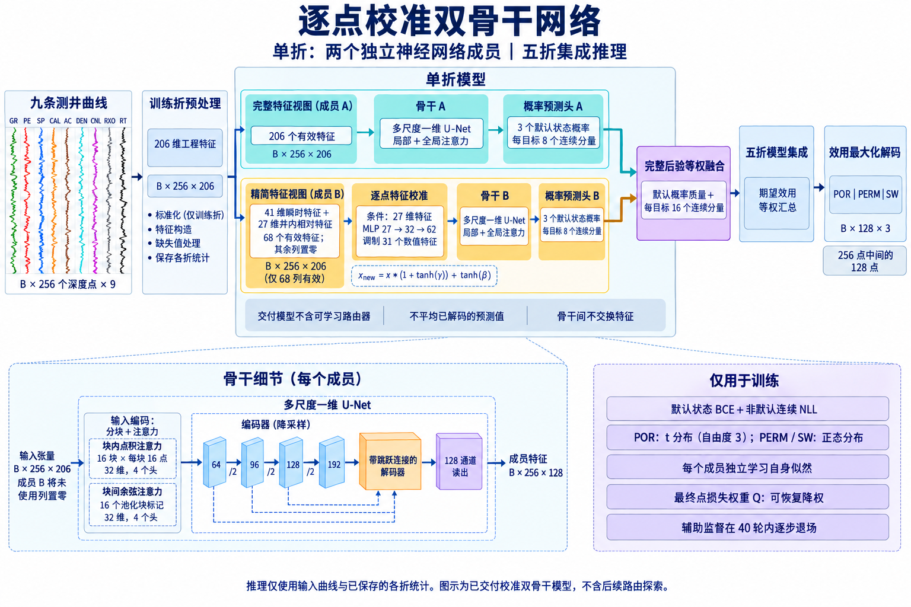

# 深度学习方法说明

本项目预测每口井每个深度点的 **POR、PERM、SW 三个参数**。井内模型读取相邻深度上下文，井间共享训练得到的参数；不把多口井的序列拼接后做 attention。

结构图展示已交付的校准双骨干方案：上半部分为单折双成员预测、五折融合与解码，下半部分为每个成员的骨干细节及训练损失。图由 imagegen 生成并人工核对；解码器画为带跳跃连接的概括模块，具体实现和张量定义以下文为准。后续的输入路由、局部路由和后验路由属于独立探索，不在本图中。

当前完整核验的最佳五折官方 OOF 为 **81.71323318479078**，此前完整基线为 **81.5027197525581**，增加 **0.21051343223268**。尚未达到完整 OOF >82 的目标。详见 [实验记录](EXPERIMENTS.md)。测试集没有标签，不报告测试精度。

## 数据和特征

原始训练集 80 口井；三个目标同时有效的样本共 723,556 行。实际使用九条曲线：GR、PE、SP、CAL、AC、DEN、CNL、RXO、RT，排除 DEVI、AZIM、BIT、CASE 及其衍生。输入保留相对深度，模型不使用绝对深度通道。

每折分别拟合训练统计。原九曲线生成 206 维输入，包括瞬时值、缺失标记、组合特征和输入曲线的局部/井内统计。标准化使用该折训练数据的中位数与尺度，再截断到 [-8,8]。井内排名等特征可读取当前预测井的完整输入曲线，但不使用其标签；这属于整井输入可用的离线预测，不是只能看过去的在线预测。

最佳完整模型每折有两个成员：

| 成员 | 视图与校准 |
|---|---|
| 0 | 完整 206 维工程特征 |
| 1 | 41 维瞬时视图 + 27 维井内校准视图，共 68 维；其他标准化列置零 |

41 维由原九曲线、3 个对数特征、相对深度、9 个缺失标记，以及 19 个同深度曲线比值/乘积/物理组合构成。27 维为九曲线各自的 `WELL_RANK`、`WELL_ZIQR`、`WELL_QNORM`。完整名单由模型文件与 feature contract 保存，运行时检查列名、数量和顺序。

成员 1 的逐点条件网络读取这 27 维，结构为 `27→32→62`，中间 GELU，输出两个 31 维向量。对 41 维中的 31 个数值列应用：

\[
x'_i=x_i\bigl(1+\tanh\gamma_i(c)\bigr)+\tanh\beta_i(c).
\]

9 个缺失标记、相对深度和 27 个条件列保持不变。末层零初始化，初始变换为恒等。它是随深度点变化的输入校准，不是用目标拟合整井趋势，也不是两个成员共享适配器。

## 骨干和输出

每个成员都是 global-cosine U-Net，通道宽度 64/96/128/192，三次低通后降采样和跳跃连接。残差块使用逐深度通道 LayerNorm、kernel=7 的 depthwise 卷积、逐点投影、GELU、常数 0.5 门控及可学习残差幅度；无 Dropout、无额外 point-MLP 旁路。

stem 中的分层 attention 将 256 点划成 16 个 patch，每个 patch 16 点：patch 内点 attention 为 dot product；patch 汇总 token 间为 cosine attention；均为 32 维、4 头。有效点 mask 隔离井边界填充。主头输入为 128 通道，中/粗尺度有辅助预测头。

批量输入形状为 `B×256×206`，相对深度及有效 mask 为 `B×256`。每成员每头输出：

- 默认值 logits：`B×L×3`；
- 混合分布参数：`B×L×3×3×8`，分别是分量权重 logits、均值、尺度原始参数。

训练/滑窗推理主要使用窗口中间 `[64:192]` 的 128 点。全井预测按原行顺序覆盖每一点；边界不足使用 mask，而非跨井取值。

## 分布和损失

默认状态按原标签定义：POR≤0.1、PERM≤0.01、SW≥99.9。连续目标分别变换为 `log1p(POR)`、`log10(PERM)`、`ln(SW)`，再以该折非默认训练标签的中位数/IQR 标准化。

令默认指示为 \(d_{ic}\)，默认概率为 \(p_{ic}\)，连续密度为 \(f_{ic}\)。每点完整预测损失为：

\[
\ell_i=\frac13\sum_{c=1}^3\left[
\operatorname{BCE}(p_{ic},d_{ic})
-(1-d_{ic})\log f_{ic}(z_{ic})\right],\qquad
L=\frac1N\sum_i Q_i\ell_i.
\]

默认标签仍监督 BCE，但不进入连续 NLL。\(Q_i\) 作用于完成后的点级预测损失，分母仍是原有效点数量，不以权重和重新归一化。每个连续密度有 8 个分量，尺度参数为 `softplus(raw)+0.025`。POR 使用 Student-t(df=3)，其 scale=std/√3；PERM、SW 使用 Normal，故三通道中的 std 均表示实际分量标准差。

每成员损失为主头损失加辅助损失：

\[
L_m=L_{m,\mathrm{main}}+
\max(0,1-e/40)\left(0.2L_{m,\mathrm{mid}}+0.1L_{m,\mathrm{coarse}}\right).
\]

这里 \(e\) 从 0 开始，两个成员的 \(L_m\) 等权平均。辅助分布上采样后对原标签计算损失，不平均标签制造平滑目标。

## 全点质量权重 Q

每折维护覆盖所有有效训练点的全局表，第五折为 578,891 个训练点。每次 probe 逐点计算 NLL、连续分布熵、目标尾部概率、默认概率及两次分布 CDF 的变化；仅使用训练点标签。观察通常在第 1 轮及之后每个偶数轮进行，更新权重从下一轮生效。

判定不是“loss 高就降权”：从第 10 轮开始，某通道需同时满足训练点 NLL≥P90、熵≤P40、双侧尾概率<0.02、CDF 变化≤中位数、默认概率<0.5，且连续三次记录成立，才暂记为持续条件冲突并降至 0.2。多通道同时冲突可降至 0.1。恢复条件为尾概率≥0.1 且 NLL≤P75，连续两次记录成立后权重乘 2，最高恢复到 1。

这是疑似坏点线索，不是已确认标签错误；困难但不满足持续窄分布冲突条件的点不自动降权。最终点权重取三个通道证据权重的最小值，施加到完整点损失。默认连续通道保持中性；当前实现不对整井或整块自动施加惩罚，井/块归属用于追踪统计。

## 正确融合与指标对齐解码

默认原子与连续密度必须一起融合。两成员默认概率 \(p_m\)、混合权重 \(\pi_m=1/2\) 时：

\[
p=\sum_m\pi_mp_m,\qquad
\widetilde\pi_m=\frac{\pi_m(1-p_m)}{\sum_j\pi_j(1-p_j)}.
\]

连续部分按 \(\widetilde\pi_m\) 组合成 16 个分量，不能简单将条件分量都赋 1/16。推理把每折密度积分到该折训练统计确定的支持网格，再以原官方评分核计算动作的期望收益：

\[
\hat y=\arg\max_{a\in\mathcal A}\mathbb E_{Y\sim P}[K(a,Y)].
\]

PERM 核基于 log10 绝对差，POR/SW 核基于真实值相对误差容限 0.08/0.05。默认值也是候选动作。五折交付先等权平均完整后验对应的期望收益，再选动作；不平均已解码的预测值。SW 输出仍为原百分数尺度。

## 训练与证据边界

沿用原始 `GroupKFold(5)` 按井划分，固定种子 20261006+折索引。探索使用原第五折，不重抽井、不换种子，不使用测试标签、树模型、预训练权重、伪标签、OOF 拟合权重或逐行最优选择。

已交付模型对应历史 **75 轮、patience=18、min10、batch64、每轮64步、LR0.0006、AdamW decay0.01、cosine75×64**。每折直接恢复本折验证官方 TOTAL 最好的 checkpoint，不在选择轮次后重训。后续新实验为 80 轮并同步 cosine 周期；早期学习率轨迹也改变，不能说仅追加 5 轮。

当前新晋级要求为第五折严格 **>80.4**；已交付 75 轮实验按此前 >80.2 规则获准补折，不追溯改写其条件。重复第五折筛选和验证最佳 epoch 选择会产生选择偏差；小幅提升不等于多种子稳定收益。最终完整 OOF 与未知标签测试预测必须分开报告。

远程仓库只保留源码和紧凑结果，不提交数据、权重或 ZIP。独立推理工程由仓库 `package_dl/` 入口组织；本地交付目录为 `D:/match_predict/submission_calibrated_pair`。恢复真实推理需要另行提供对应五折权重，不能用空模型声称复现精度。
