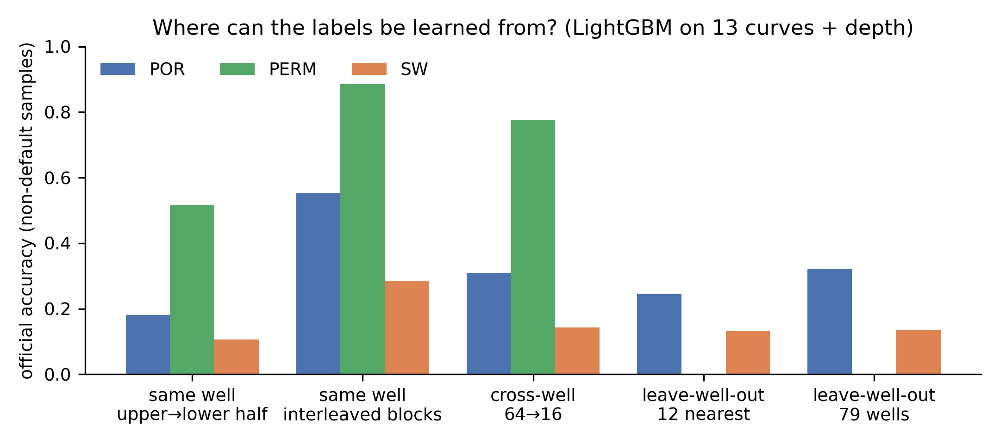
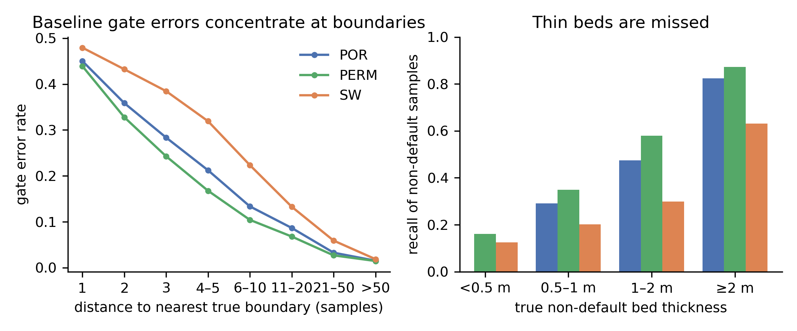
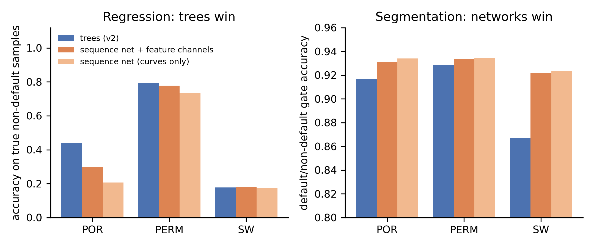
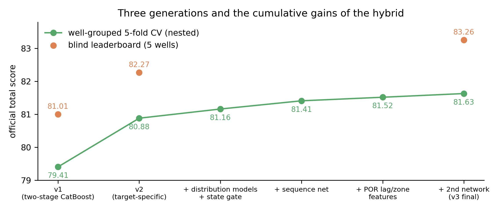
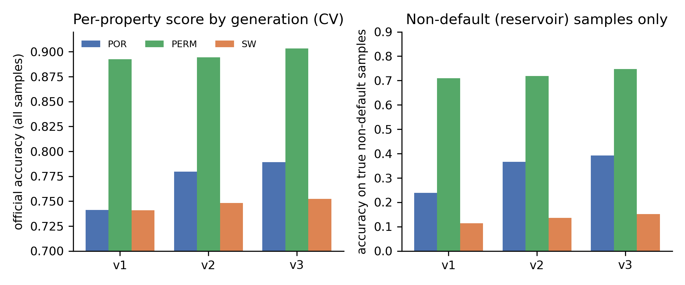
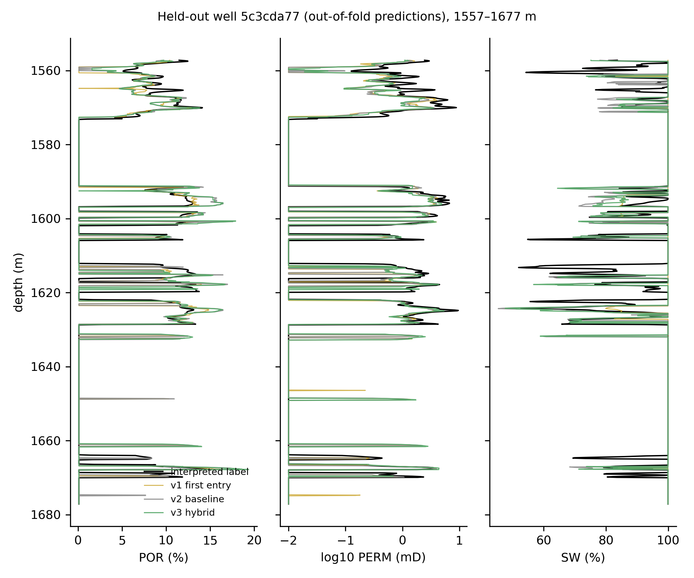
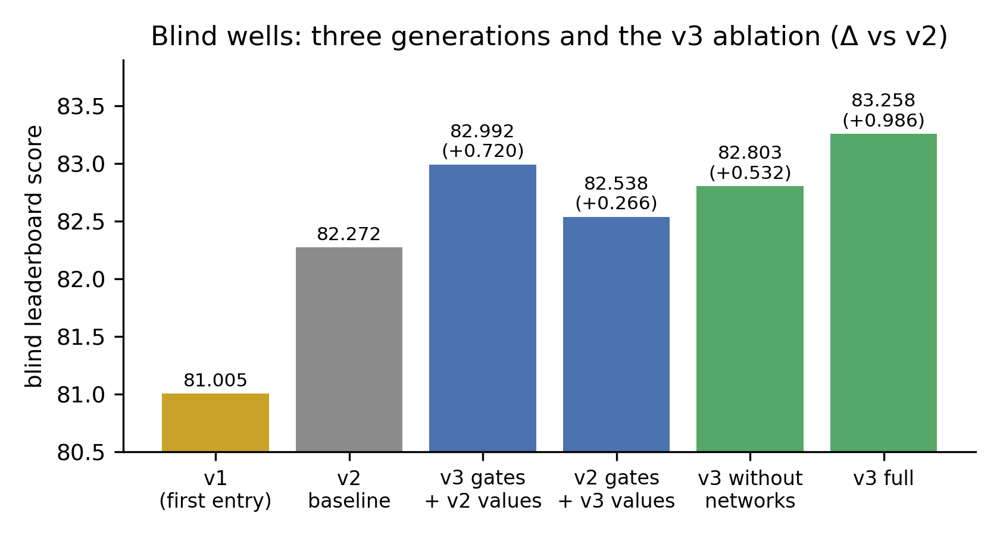

# Paper draft for Geodata and AI (Original Research Paper)

> Status: draft updated 2026-09-20 with blind-well (leaderboard) scores. All other numbers are from the 5-fold well-grouped cross-validation on the
> 80 training wells. References marked
> "[verify DOI]" must be checked before submission; do not submit unverified references.
> Journal rules applied: abstract <= 250 words, 1-7 keywords, double-anonymised (no author identifiers in text),
> generative-AI declaration section before references.

---

## Title

**Where the log ends: identifiability limits and a metric-aligned tree–sequence hybrid for reservoir-property prediction from wireline logs**

Short title: Metric-aligned hybrid prediction of POR/PERM/SW from well logs

## Abstract (≤ 250 words)

Predicting porosity (POR), permeability (PERM) and water saturation (SW) at every depth sample from conventional wireline logs is a long-standing task that is increasingly evaluated with tolerance-based accuracy scores rather than squared error. Using a 90-well benchmark (80 training wells, 730,268 samples; 10 blind wells) scored by a relative-tolerance metric, we first quantify how much of the interpreted labels is recoverable from the logs at all. Half-well hold-out within a single well, interleaved-block hold-out, leave-well-out with nearest-well training, and a differencing analysis show that only 36–42 % of the sample-to-sample label variation is explained by lagged log variation and that the labels carry information (zonation, core calibration) absent from the thirteen input curves. This sets a ceiling that no model of the logs alone can exceed. We then show that gains within this ceiling come from three structural changes rather than from tuning: (i) decoding quantile-binned predictive distributions with the Bayes action of the official tolerance kernel instead of the argmax or the mean; (ii) modelling the four physically consistent reservoir states jointly instead of three independent default-value gates; and (iii) a whole-well dilated convolutional network whose segmentation head reduces gate error by up to 40 % while its regression head remains inferior to gradient-boosted trees, motivating a division of labour rather than a replacement. A nested, low-dimensional fusion of the two model families raises the official score from 80.88 (previous target-specific system; 79.41 for the original two-stage system) to 81.63 under well-grouped cross-validation, with paired well-level bootstrap intervals excluding zero for all three properties, and from 82.27 to 83.26 on the five blind leaderboard wells, where ablation submissions show the segmentation and regression gains to be exactly additive (+0.72 and +0.27).

## Keywords

well logs; petrophysics; gradient boosting; sequence model; decision theory; benchmarking; reservoir characterisation

## Highlights (3–5 bullets, ≤ 85 characters each)

- Interpreted POR/PERM/SW labels contain information absent from the input logs.
- Bayes-action decoding of binned distributions matches tolerance-based metrics.
- Whole-well dilated CNN segments reservoir states better than pointwise trees.
- Trees regress, networks segment: nested fusion gains +0.75 official points.
- All comparisons use one well-grouped split with nested selection and bootstrap CIs.

---

## 1. Introduction

Reservoir parameters – porosity, permeability and water saturation – are the quantities that petrophysicists derive from wireline logs to evaluate hydrocarbon reserves and plan development. Their conventional computation relies on rock-physics relations (density–porosity transforms, Archie-type saturation equations, porosity–permeability regressions) whose coefficients are adjusted zone by zone and well by well by an interpreter [Archie 1942; Timur 1968 – verify DOI]. Data-driven alternatives promise to remove this manual calibration and generalise across wells, and gradient-boosted decision trees (GBDT) and one-dimensional neural sequence models have both been reported to predict these properties from logs [cite 2–4 recent studies; verify].

Two aspects of the practical problem are rarely addressed in this literature. First, the labels used to train and score such models are not measurements but *interpretations*: they inherit zonation decisions, default values outside the reservoir and core-calibrated coefficients that the logs do not contain. How much of a label is therefore recoverable from the logs in principle is unknown, yet it bounds every model. Second, benchmark and industrial acceptance criteria increasingly use tolerance-based accuracy (a prediction counts fully if it lies within ±8 % of the true porosity, ±5 % of the true saturation, or within one decade of the true permeability), which is a bounded, non-convex utility, whereas models are trained and selected with squared or absolute error. The point estimate that maximises expected utility under such a kernel is neither the conditional mean nor the conditional mode of the bin distribution.

This paper addresses both aspects on a 90-well benchmark from a single basin, released as a data-science challenge with the metric above. Our contributions are:

1. An *identifiability audit* that quantifies, with well-grouped and within-well experiments, the share of label variation that is explainable from the logs and the corresponding attainable ceiling of any log-only model (Section 4).
2. A *metric-aligned decision layer*: quantile-binned predictive distributions are decoded with the Bayes action of the official tolerance kernel; we show that the optimum lies on the support or a dense action grid and that this changes the answer materially for the log-ratio permeability metric (Section 3.3).
3. A *joint reservoir-state model* replacing three independent default-value classifiers with a single four-state posterior that enforces the physical consistency observed in 99.98 % of the labels (Section 3.4).
4. A *tree–sequence division of labour*: a whole-well dilated convolutional network is shown, under identical folds, to be a weaker regressor but a substantially stronger segmenter than GBDT; a nested low-dimensional fusion combines the strengths of both (Sections 3.5–3.6).

All comparisons share one well-grouped five-fold split; fusion weights and thresholds are selected on inner folds only; uncertainty is reported by paired well-level bootstrap.

## 2. Data and evaluation

### 2.1 Well-log benchmark

The dataset contains 80 training wells (730,268 samples at 0.1 m spacing, 723,556 with all three labels valid) and 10 blind test wells (95,948 samples). Thirteen input curves are available in every well (GR, SP, AC, DEN, CNL, PE, RXO, RT, CAL, BIT, DEVI, AZIM, CASE; CASE is missing in all but one well and is discarded). Labels are POR (%), PERM (mD) and SW (%). Outside the reservoir intervals the interpreter assigned default values (POR = 0.1, PERM = 0.01, SW = 99.9); these defaults cover 67.4 %, 68.4 % and 71.6 % of the labelled samples respectively. Cross-tabulating the three default flags yields four states that account for 99.98 % of samples: non-reservoir (all defaults, 67.4 %), hydrocarbon-bearing reservoir (no defaults, 28.1 %), water-bearing reservoir (POR/PERM valid, SW = 99.9, 4.3 %) and tight reservoir (POR valid, PERM = 0.01, 0.3 %). Table 1 summarises the data.

**Table 1.** Benchmark summary (training wells; blind wells have the same curves and sampling).

| Item | Value |
| --- | --- |
| Wells / samples (training) | 80 / 730,268 (723,556 with all three labels) |
| Wells / samples (blind) | 10 / 95,948 (5 wells scored on the public leaderboard) |
| Sampling; logged interval | 0.1 m; 447–1,308 m per well, 869–3,075 m depth range |
| Input curves used | GR, SP, AC, DEN, CNL, PE, RXO, RT, CAL, BIT, DEVI, AZIM (CASE discarded) |
| Missing values | −99999 sentinel; per-well missing rate ≤ 4.4 % (DEN), interpolated within the well |
| Default (non-reservoir) share | POR 67.4 %, PERM 68.4 %, SW 71.6 % of labelled samples; per-well POR default share 38–83 % |
| Reservoir states (samples) | 487,557 non-reservoir / 203,289 hydrocarbon-bearing / 30,804 water-bearing / 1,906 tight |
| Non-default label range (P5 / median / P95) | POR 4.9 / 11.6 / 20.0 %; PERM 0.03 / 0.97 / 26 mD; SW 45.9 / 80.3 / 97.3 % |
| Non-default bed thickness | median 15 samples (1.5 m); 5 % of beds ≤ 3 samples |

### 2.2 Official metric

For a property with truth y and prediction ŷ the per-sample accuracy is
Acc_POR = max(0, 1 − |ŷ − y| / (0.08 |y|)), Acc_SW = max(0, 1 − |ŷ − y| / (0.05 |y|)), Acc_PERM = max(0, 1 − |log10(ŷ / y)|),
and the total score is 100 × (0.30 Acc_POR + 0.35 Acc_PERM + 0.35 Acc_SW) averaged over samples. The kernels are triangular in relative (POR, SW) or logarithmic (PERM) error and vanish outside the tolerance. Consequences: a default-value sample predicted as reservoir (or vice versa) scores exactly zero; inside the reservoir a relative error of 8 % (POR) or 5 % (SW) already scores zero, so an unbiased Gaussian relative error with standard deviation 10 % attains an expected accuracy of only 0.30 (POR) and 0.20 (SW).

### 2.3 Validation protocol

All models are evaluated with the same five-fold `GroupKFold` split by well. We report the sample-weighted (micro) score, the well-averaged (macro) score, the mean of the five worst wells, the five fold scores, and the score on default and non-default samples separately. Differences to the baseline are accompanied by 95 % intervals from a paired bootstrap over wells (2,000 resamples). Any threshold or fusion weight is selected on the four inner folds and applied to the fifth (nested); the configuration used for the blind wells is selected on all five folds and reported separately as an optimistic value.

## 3. Methods

### 3.1 Baselines: the first-round entry (v1) and the target-specific system (v2)

The work builds on two earlier entries to the same benchmark, both retained here as baselines under the common protocol.

*v1 – unified two-stage CatBoost.* For every property one CatBoost classifier separates default from non-default samples and one CatBoost MAE regressor predicts the transformed value (log1p POR, log10 PERM, raw SW) on non-default samples, using 113 hand-crafted features (raw curves, logarithms and ratios, per-well medians, standard deviations and ranks, 9/51/201-sample rolling means and standard deviations, differences and trends). Threshold, scale and offset were chosen on a 3-fold out-of-fold grid; the final models were trained for a fixed 500 iterations, whereas the cross-validation models had used early stopping (about 85–150 iterations), an estimator mismatch that cost about 0.3 points. v1 scored 81.01 on the blind leaderboard (rank 237); reproduced under the 5-fold protocol used here with the submitted fixed-iteration estimator it scores 79.41 (79.79 with the early-stopped cross-validation estimator that was never submitted), see Table 5.

*v2 – target-specific models.* v2 keeps the gates but treats each property differently: an 80-bin multiclass model on log1p(POR) decoded by the argmax bin median, an MAE regressor on log10(PERM), and an RMSE regressor on SW with 237 features (adding per-well quantile normalisation, local residuals, slopes and rock-physics proxies such as density and sonic porosity, a GR shale index, an Archie-type proxy and the invasion contrast), two seeds per model, and thresholds/affine calibrations selected on out-of-fold predictions. v2 scored 82.27 on the blind leaderboard and 80.88 in our cross-validation; the POR binning alone accounted for about 0.8 of the 1.1-point CV gain over v1, i.e. discretising the target already moved the point estimate away from the conditional mean and towards the tolerance kernel's optimum – the observation that motivates the decision layer of Section 3.3.

### 3.2 Additional lag and zone features

We add 181 features computed only from the input curves of the same well: ±1–3 sample lag differences, 3/5-sample medians and residuals, first and second differences of eight curves, the density–neutron separation and its lags, and 60 m / 150 m rolling median, standard deviation, residual and P10/P90 of seven curves, plus distance to the top and bottom of the logged interval. The long windows act as a label-free proxy of the formation the sample belongs to.

### 3.3 Distribution models and Bayes-action decoding

For each property we train a CatBoost multiclass model on the non-default samples with K quantile bins of the transformed label (K = 80 for log1p POR, 60 for log10 PERM, 60 for SW). Given bin probabilities p_j and bin representatives y_j, the decision layer returns
a* = argmax_a Σ_j p_j Acc(a, y_j)
where Acc is the official kernel of that property. Because Acc(·, y_j) is piecewise linear in a with its only maximum at y_j, Σ_j p_j Acc(a, y_j) is piecewise linear and its maximum is attained at some y_j; we nevertheless evaluate the expected utility on an 800-point dense action grid (uniform in SW, log-uniform in POR/PERM) to remove bin-centre quantisation and to allow mixtures of distributions with different supports. A joint variant appends the default value with mass p_default to the support and removes the threshold altogether.

### 3.4 Joint reservoir-state model

A single CatBoost multiclass model predicts the four states of Section 2.1 from the 113 + 181 features. The per-property default probability is the marginal (state 0 for POR; states 0 + 3 for PERM; states 0 + 2 for SW). This shares evidence across properties and forbids inconsistent combinations that the independent gates produce in 2.4 % of samples.

### 3.5 Whole-well dilated convolutional network

Input channels per well: ten curves, each as a globally robust-scaled and a within-well robust-scaled channel, ten missing-value masks, relative and absolute depth (32 channels); an optional variant appends the 113 baseline features as channels. The network is a stack of twelve residual blocks of dilated 1-D convolutions (kernel 5, dilations 1–32 repeated twice, GroupNorm, squeeze–excitation), followed by concatenation with a global context vector (mean-pooled over the whole well) and three heads, one per property, each emitting a gate logit and K bin logits. Training uses random 3,072-sample crops (≈ 300 m), per-curve gain/offset jitter to simulate calibration drift, AdamW with a one-cycle schedule, bf16, and masked cross-entropy losses (gate weight 1, bin weight 0.3 or 1.0). Inference processes each well in one pass. The network is trained under the same five well folds and written to the same out-of-fold format as the trees.

### 3.6 Nested fusion

For each property the continuous decision is the Bayes action of a convex mixture of the available predictive distributions (tree bins, network bins) and the gate is a convex mixture of the available default probabilities (tree gate, state marginal, network gates), thresholded once. Mixture weights lie on a simplex grid with step 0.25 and the threshold on a grid of 89 values; the exact score of every threshold is computed by sorting. Selection is nested as described in Section 2.3.

## 4. Identifiability audit

Table 2 (from `diag_wells.json`, `diag_hf.json`, `diag_gate.json`):

| Experiment (non-default samples, LightGBM on 13 curves + depth) | POR | PERM | SW |
| --- | ---: | ---: | ---: |
| Same well, upper half → lower half | 0.181 | 0.517 | 0.106 |
| Same well, interleaved 50-sample blocks | 0.553 | 0.885 | 0.286 |
| Cross-well, 64 → 16 wells | 0.309 | 0.776 | 0.143 |
| Leave-one-well-out, 12 / 30 / 79 nearest wells | 0.245 / 0.302 / 0.322 | – | 0.132 / 0.135 / 0.134 |
| Share of Δ-label variance explained by lagged Δ-curves (linear) | 0.36 | 0.42 | 0.42 |
| 5-sample rolling-median oracle of the label itself | 0.905 | 0.981 | 0.860 |

**Fig. 1.** Identifiability audit: official accuracy of a LightGBM model on non-default samples under five data splits (same well upper→lower half; same well interleaved 50-sample blocks; cross-well 64→16; leave-well-out with the 12 nearest wells; leave-well-out with all 79 wells). Labels transfer better from other wells than from the other half of the same well, and nearest-well training does not help. Bars for PERM are omitted where the experiment was not run.

Three observations. (a) Training on the upper half of a well does not transfer to its lower half; the mapping from logs to labels is formation-specific, and 79 other wells transfer better than the well itself. (b) Even with neighbouring labelled samples five metres away (interleaved blocks), SW reaches only 0.29 under the 5 % tolerance. (c) The labels are smooth at the 0.5 m scale (rolling-median oracle > 0.86) but their variation is only weakly coupled to the curves' variation; the remainder must originate in the interpretation workflow. The attainable ceiling of any log-only model is therefore far below the metric's nominal maximum, and cross-well generalisation is not the limiting factor.

Gate anatomy (Table 3, Fig. 2): the baseline gate errs on 8.3 % (POR), 7.1 % (PERM) and 13.3 % (SW) of samples; 27–47 % of the errors lie within two samples of a true boundary; the recall of non-default beds thinner than 1 m is 0.29 (POR) and 0.20 (SW). Repairing only the errors farther than two samples from a boundary would add 0.030, 0.029 and 0.017 to the three accuracies – the largest reachable reserve in the data.

**Fig. 2.** Anatomy of the baseline (v2) gate errors. (a) Gate error rate versus distance to the nearest true default/non-default boundary; (b) recall of non-default samples by true bed thickness. About half of the errors lie within five samples of a boundary, and beds thinner than 1 m are recalled at only 20–35 %.

## 5. Results

### 5.1 Decision layer alone (no retraining)

Bayes-action decoding of the baseline POR distribution raises non-default accuracy from 0.438 (argmax) to 0.443, and the full score from 0.7796 to 0.7802 (95 % CI of the paired difference [−0.0002, +0.0016]); the joint default-mass variant reaches 0.7810 ([+0.0003, +0.0012]). Median or HMM smoothing of gate probabilities, isotonic or temperature calibration of the gates, and a four-state HMM over the state posterior change the score by less than 0.001 or reduce it. Nested re-selection of thresholds reproduces the baseline's thresholds, i.e. the baseline was not optimistically calibrated.

### 5.2 Distribution models with metric-aligned decoding

| Model | Non-default acc. (baseline → new) | Full score with baseline gate | Paired CI, wells improved |
| --- | ---: | ---: | --- |
| PERM: 60-bin distribution + log-ratio Bayes action | 0.792 → 0.805 | 0.8944 → 0.8969 | [+0.0023, +0.0053], 61/80 |
| POR: 80-bin distribution + lag/zone features | 0.438 → 0.453 | 0.7796 → 0.7836 | [+0.0023, +0.0079], 54/80 |
| SW: 60-bin distribution | 0.177 → 0.177 | 0.7484 → 0.7475 | [−0.0025, +0.0004], 30/80 |

For permeability the decoded action differs systematically from the MAE regression output because the log-ratio kernel is asymmetric in the original scale; for saturation the distribution model brings no information the regressor lacked, consistent with Section 4.

### 5.3 Joint state model

State accuracy is 0.905. Using its marginals as gates with nested thresholds gives POR 0.7819, PERM 0.8961 (averaged with the baseline gate), SW 0.7493; all three paired intervals exclude zero. Smoothing the posterior with the empirical transition matrix reduces all three scores, because short states (water-bearing streaks of 1–4 samples) are genuine in the labels.

### 5.4 Sequence network

| Run | Non-default acc. POR / PERM / SW | Gate accuracy POR / PERM / SW | Total alone |
| --- | --- | --- | ---: |
| Baseline trees | 0.438 / 0.792 / 0.177 | 0.917 / 0.929 / 0.867 | 80.88 |
| Network, curves only (3 seeds) | 0.208 / 0.736 / 0.173 | 0.934 / 0.935 / 0.923 | 77.65 |
| Network + 113 feature channels (2 seeds) | 0.299 / 0.777 / 0.179 | 0.931 / 0.934 / 0.922 | 78.87 |

The network halves the SW gate error (13.3 % → 7.7 %) and reduces the POR gate error by 20 %, but its regression heads are clearly inferior to the trees for POR and PERM (Fig. 3). Used alone it loses 2–3 points; used as a gate source it is the single largest contributor to the final gain.

**Fig. 3.** Trees versus sequence networks under identical well folds. (a) Accuracy on true non-default samples (regression task); (b) default/non-default gate accuracy at threshold 0.5 (segmentation task). Gradient-boosted trees regress better; whole-well networks segment better, most visibly for water saturation.

### 5.5 Nested fusion

| Configuration | POR | PERM | SW | Total |
| --- | ---: | ---: | ---: | ---: |
| v1 first-round entry (two-stage CatBoost, reproduced under the same folds with the submitted fixed-iteration estimator) | 0.7412 | 0.8925 | 0.7411 | 79.41 |
| v2 baseline (target-specific) | 0.7796 | 0.8944 | 0.7484 | 80.88 |
| + distribution models, state-model gate | 0.7830 | 0.8993 | 0.7485 | 81.16 |
| + network (gates and distributions) | 0.7855 | 0.9022 | 0.7506 | 81.41 |
| + POR lag/zone features | 0.7891 | 0.9022 | 0.7506 | 81.52 |
| + second network with feature channels (v3, final) | **0.7893** | **0.9034** | **0.7524** | **81.63** |

The nested selection picks the same configuration in all five outer folds: tree distributions for POR, a 0.75/0.25 tree/network mixture for PERM, a 0.5/0.25/0.25 mixture for SW, and gates dominated by the state model and the networks with the baseline gate receiving zero weight for POR and SW. Paired intervals versus the baseline: POR [+0.0070, +0.0123] (66/80 wells), PERM [+0.0061, +0.0096] (70/80), SW [+0.0005, +0.0042] (49/80). The worst five wells also improve for all three properties. Optimistic (non-nested) selection gives 81.65, i.e. the nesting cost is 0.02 points. Fig. 4 shows the progression across the three generations and the fusion steps; Fig. 7 breaks the three generations down by property.

**Fig. 4.** Nested cross-validation total score of the three generations (v1, v2) and of each fusion step of v3 (line), with the blind leaderboard scores of v1, v2 and v3 (points). The leaderboard exceeds the cross-validation score by a nearly constant 1.4–1.6 points in every generation.

**Fig. 7.** Per-property cross-validation accuracy of v1, v2 and v3 on all samples (left) and on non-default samples only (right). POR gained most from v1 to v2 (target discretisation); SW and PERM gained most from v2 to v3 (segmentation and metric-aligned decoding).

*Saturation.* Adding further sources to the fusion – a four-seed POR distribution model, a 100-bin PERM model with stacked features, a four-seed SW model with the POR-distribution summaries as inputs, a third network with a wider kernel, and a level-2 CatBoost state model trained on all first-level outputs (state accuracy 0.905 → 0.908) – changes the nested total by at most +0.008 (81.632 → 81.640). The linear mixture with a single threshold already extracts what the sources agree on; the remaining errors are shared by all models and, per Section 4, are largely not a function of the logs. Fig. 6 illustrates the behaviour of the three generations on a held-out well.

**Fig. 6.** Held-out well 5c3cda77, 1557–1677 m: interpreted labels (black) versus out-of-fold predictions of v1 (yellow), v2 (grey) and v3 (green) for POR, log10 PERM and SW. v3 removes spurious reservoir flags in shale (e.g. 1648 m, 1674 m) and follows thin-bed boundaries more closely; the residual SW error inside the reservoirs is shared by all three generations.

### 5.6 Blind wells

Table 6 reports the official leaderboard score on the five blind A-board wells (95,948 samples in ten wells are predicted; five are scored). The three generations and four same-day ablation submissions of the final system are:

| Submission | Blind score | Δ vs v2 | CV Δ (nested) |
| --- | ---: | ---: | ---: |
| v1 first-round entry (two-stage CatBoost; rank 237 at the time) | 81.0052 | −1.2666 | −1.48 |
| v2 baseline (target-specific) | 82.2718 | – | – |
| Final system (v3) | **83.2579** | **+0.9861** | +0.749 |
| Final gates, v2 continuous values | 82.9916 | +0.7198 | – |
| v2 gates, final continuous values | 82.5381 | +0.2663 | – |
| Final system without the sequence networks | 82.8034 | +0.5316 | +0.348 |

Across the three generations the blind score rose by 2.25 points (81.01 → 82.27 → 83.26) while the 5-fold CV rose by 2.22 (79.41 → 80.88 → 81.63); the blind-well score exceeds the CV score by a nearly constant 1.4–1.6 points for all three generations, so the well-grouped protocol ranks candidates correctly and predicts the size of the gains. The gate contribution (+0.72) and the continuous-value contribution (+0.27) of v3 sum exactly to the full gain (+0.99): the two improvements are additive on unseen wells, as the metric's structure predicts (a gate error scores zero regardless of the continuous value). Removing the sequence networks costs 0.45 points on the blind wells (0.40 in CV); the tree-side changes alone are worth 0.53 (0.35 in CV) (Fig. 5).

**Fig. 5.** Blind leaderboard scores of the three generations and of the four v3 ablation submissions (differences relative to v2 in parentheses). The gate-only (+0.72) and value-only (+0.27) gains add up to the full v3 gain (+0.99).

## 6. Discussion

*What the ceiling means for practice.* The audit shows that roughly 60 % of the sample-to-sample variability of interpreted porosity is not a function of the logs at the same or neighbouring depths, and that an interpreter's zonation transfers better across wells than across the halves of one well. For operators this argues for releasing zone tops and calibration coefficients alongside labels when building training sets, and for evaluating models against interpretable ceilings rather than against the metric's nominal maximum.

*Why trees regress and networks segment.* GBDT with per-well and rolling statistics captures the pointwise conditional distribution well; the sequence network, with a receptive field of hundreds of metres and a global context vector, captures where beds start and end and suppresses the fragmentation (365 vs 250 state changes per 10,000 samples) that pointwise gates produce. Both observations are stable across seeds and folds; the fusion assigns the network zero weight for POR regression and the baseline gate zero weight for POR and SW segmentation.

*Metric alignment.* Decoding with the Bayes action is cheap and always safe when the distribution is well calibrated; its value depends on the kernel: negligible for the narrow POR kernel where argmax and Bayes action coincide in most bins, substantial for the log-ratio PERM kernel.

*Negative results worth recording.* (i) Smoothing gate probabilities along depth (median filters, two-state or four-state hidden Markov smoothing with the empirical transition matrix) never helped and often hurt, because genuine one-to-four-sample states (water streaks, tight streaks) exist in the labels. (ii) Calibrating the gate probabilities (isotonic, temperature) before a joint Bayes decision changed the score by less than 0.001. (iii) A level-2 CatBoost state model stacked on all first-level outputs raised state accuracy from 0.905 to 0.908 but added nothing after the linear fusion. (iv) Transductive self-training of the sequence networks with hard pseudo-labels on the held-out wells (simulated within the folds) raised their stand-alone scores from 77.6 to 81.3 (curves-only network) and from 78.9 to 81.5 (network with feature channels) – they learned to imitate the ensemble – but lowered their SW gate accuracy from 0.923 to 0.886 and from 0.922 to 0.892, because the pseudo-labels carry the fused decision's threshold bias; the fusions that include the transduced networks scored 81.61–81.64 against 81.63 without them, i.e. within fold noise. Soft-probability distillation rather than hard decisions would be the correct form of transduction, which we leave to future work.

*Limitations.* One basin, one metric; only tolerance kernels of this form were studied; the sequence network was not tuned beyond three architectures; the blind-well evaluation contains five scored wells and is therefore noisy (one well shifts the score by up to 0.7 points), although the four ablation submissions are mutually consistent to within 0.01 points.

## 7. Conclusions

(1) Interpreted reservoir labels are only partly identifiable from conventional logs; the audit procedure proposed here gives a practical ceiling. (2) Aligning the decision layer with the tolerance metric is a free improvement for log-ratio permeability. (3) Whole-well sequence networks and gradient-boosted trees have complementary strengths – segmentation versus regression – and a nested fusion of the two is the most robust path to gains, whereas replacing one by the other loses points. (4) On the benchmark the official score improves over three generations from 79.41 (v1) to 80.88 (v2) to 81.63 (v3) in well-grouped cross-validation and from 81.01 to 82.27 to 83.26 on the blind leaderboard wells, with the segmentation and regression contributions of the final generation verified to be additive by ablation submissions.

## Figure and table index

Figures are embedded above at their positions; source files are in `reports/figures/` (300 dpi PNG, vector PDF, and the underlying numbers as CSV). Figure numbers follow first citation order in the text except Fig. 7, which is placed next to Fig. 4 because both compare the generations.

- **Fig. 1** `fig1_identifiability` (Section 4) · **Fig. 2** `fig2_gate_anatomy` (Section 4) · **Fig. 3** `fig3_division_of_labour` (Section 5.4) · **Fig. 4** `fig4_progression` (Section 5.5) · **Fig. 5** `fig5_leaderboard_ablation` (Section 5.6) · **Fig. 6** `fig6_example_well` (Section 5.5) · **Fig. 7** `fig7_generations_per_target` (Section 5.5).
- **Fig. 8** `fig8_typewell` (Discussion, type-well selection): four similarity criteria (median-curve distance, KL divergence, GR-DTW, composite DTW) × 12 / 30 nearest wells / similarity-weighted all wells versus all 79 wells; no criterion beats pooling on this benchmark.
- **Table 1** – Data summary (Section 2.1). **Table 2** – Identifiability audit (Section 4). **Table 3** – Gate anatomy numbers (Section 4, text). **Table 4** – Distribution models (5.2). **Table 5** – Fusion (5.5). **Table 6** – Blind wells (5.6).

## Declaration of generative AI and AI-assisted technologies in the manuscript preparation process

During the preparation of this work the authors used an AI coding assistant (Claude, Anthropic) to draft analysis code, run experiments under the authors' specification, and produce a first draft of the text. After using this tool the authors reviewed and edited the content as needed and take full responsibility for the content of the published article.

## Data availability

The benchmark data are the property of the competition organiser; access conditions are described at [URL]. Code for all experiments (feature construction, CatBoost and network training, decision layer, nested fusion, diagnostics) will be deposited at [Mendeley Data / repository DOI].

## References (verify every DOI before submission)

- Archie, G.E., 1942. The electrical resistivity log as an aid in determining some reservoir characteristics. Trans. AIME 146, 54–62. https://doi.org/10.2118/942054-G [verify]
- Timur, A., 1968. An investigation of permeability, porosity, and residual water saturation relationships for sandstone reservoirs. The Log Analyst 9(4). [verify]
- Prokhorenkova, L., Gusev, G., Vorobev, A., Dorogush, A.V., Gulin, A., 2018. CatBoost: unbiased boosting with categorical features. Advances in Neural Information Processing Systems 31. [verify]
- Ke, G., et al., 2017. LightGBM: a highly efficient gradient boosting decision tree. Advances in Neural Information Processing Systems 30. [verify]
- Bai, S., Kolter, J.Z., Koltun, V., 2018. An empirical evaluation of generic convolutional and recurrent networks for sequence modeling. arXiv:1803.01271 (preprint). [verify]
- Berger, J.O., 1985. Statistical Decision Theory and Bayesian Analysis, 2nd ed. Springer. https://doi.org/10.1007/978-1-4757-4286-2 [verify]
- Rabiner, L.R., 1989. A tutorial on hidden Markov models and selected applications in speech recognition. Proc. IEEE 77(2), 257–286. https://doi.org/10.1109/5.18626 [verify]
- Pedregosa, F., et al., 2011. Scikit-learn: machine learning in Python. J. Mach. Learn. Res. 12, 2825–2830. [verify]
- Phoon, K.K., 2024. Trustworthy data-centric geotechnics. Geodata and AI 1, 100008. https://doi.org/10.1016/j.geoai.2024.100008 [verify]
- Additional recent well-log ML references (2023–2026, porosity/permeability/saturation prediction, lithology segmentation with CNNs) to be added from the literature search log in the report.
