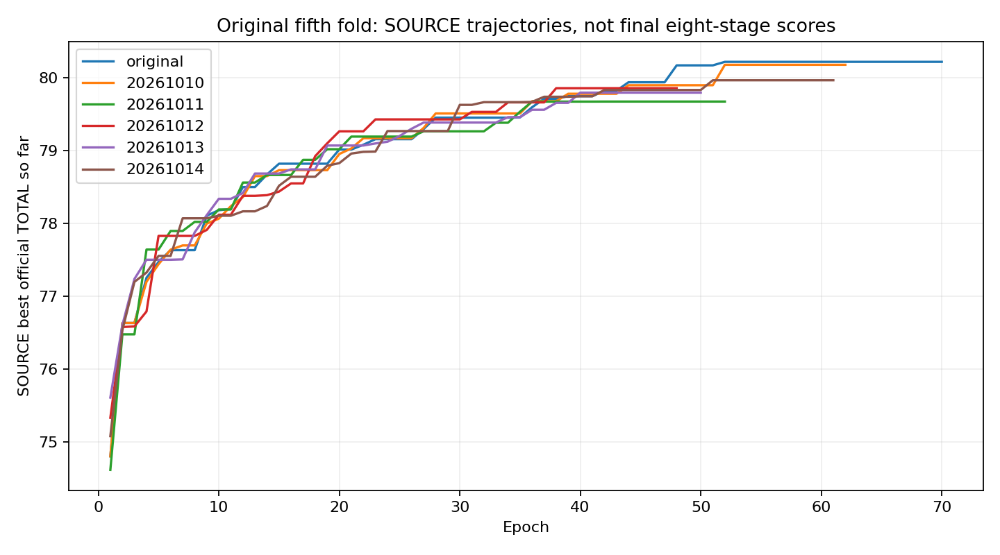

# Stage gains and deletion analysis

## Focus
User asks original versus new complete seed stage gains and valid deletion options. Same original fifth, unchanged actual artifact predictions, CPU only. Separate training gain from predecessor gain, and leaf versus intermediate deletion. Existing five-seed training continues.

## Explored and verification
AllSOURCE and7head saved predictions scored on actual144665original heldout rows, checked against their original reports. All8 combinations of dropping final341/336/351 use actual predecessor columns; no descendant trained on a deleted leaf is retained. Original V201 prefix/skip113 evidence reused.

## Gain
Observed tables below; no new training gain claimed. Historical budget/Q/parents differ from newseeds, not seed-only causal attribution.

| Stage | Original target gain | New first-seed target gain | Original TOTAL contribution | New TOTAL contribution |
|---|---:|---:|---:|---:|
| POR113 | +0.262586482 | +0.335149414 | +0.078775945 | +0.100544824 |
| POR151 | +0.385926434 | +0.000000000 | +0.115777930 | +0.000000000 |
| PERM154 | +0.060804682 | +0.000000000 | +0.021281639 | +0.000000000 |
| SW104 | +0.499368061 | +0.376288493 | +0.174778821 | +0.131700973 |
| POR341 | +0.120049957 | +0.126609528 | +0.036014987 | +0.037982858 |
| PERM336 | +0.112824542 | +0.143823418 | +0.039488590 | +0.050338196 |
| SW351 | +0.051859224 | +0.000000139 | +0.018150728 | +0.000000049 |

SW104 gain in this table compares replacement to SOURCE SW; its own random-start training gain is2.924637746686 original/2.839013676297 new. SOURCE is the prerequisite, not a claimed incremental stage gain.

## Not worth continuing / deletion advice
- Original recipe: no final phase can currently be removed with zero score loss. Least damaging proven leaf deletion is SW351, yielding seven stages; true score delta is in leaf_deletions.
- New first seed: SW351 best0/optimizergain0, leaf deletion is effectively score-neutral (tiny initializer numerical change), so seven-stage recipe is directly supported by saved predictions.
- POR151/PERM154 new first seed best0: candidate redundant optimization phases in THIS seed. Do not generalize; original151 and154 positive, and current second-seed151 has positive gain. For intermediate removal, reconstruct an untrained adapter/initializer and verify selected state equivalence, or retrain downstream POR341/PERM336 from the retained earlier source. Existing trained descendants do not establish deletion.
- Prior direct skip113 experiment V201 has final POR77.415345964852 vs retained15177.926380760724 (-0.511034795872); this evidence does not support deleting113. Historical patience18 vs skip14 disclosed.
- If targeting six stages next, merge PERM154 and336 into one fresh joint encoder/readout phase from SOURCE first (not from trained154); this is untested and requires new matched fifth validation. Alternatively merge SW104/351 jointly from random SW body, also untested. Preserve existing original8 until gains are verified.
- Do not remove SOURCE while still loading its trained weights; that retains SOURCE training cost. Removing it requires a separately cold-trained architecture/input-quality recipe.
- Historical original stages use18/14 patience, newseeds10->14 plus their ownSOURCE/Q/parent checkpoints. Gain differences cannot be attributed to seed or patience alone; all current five-seed runs remain unchanged.

## Timing, limitations and pending
CPU analysis 1.410s includes source preparation read/scoring/assembly; no GPU or training added. Full original OOF>82 and fifth>80.8 still unmet. No deletion of weights or code performed. Any proposed intermediate merge/skip is untrained; finish5seeds then decide a scoped comparison. FINAL.json preserves all per-channel DEFAULT/CONT, leaf scores and exact artifact comparisons.

## 中文分析汇总（修复编码后的最新记录）

### 探索重点
比较原80.706130八阶段模型与新种子各阶段实际增益，判断末端删除、中间阶段省略优化与合并训练的边界。原第五折144665点、CPU只读现有预测/报告/学习曲线，不增加GPU训练，不改变五种子八阶段配方。

### 已探索的内容与验证
原模型和第一个新种子的SOURCE与七个头已逐项复算，末端POR341/PERM336/SW351全部八种保留组合实际组装评分；见FINAL.json。第二个种子完整八阶段、第三个种子四阶段实际预测已复算，分别见SEED20261011_STAGE_SNAPSHOT.json与SEED20261012_STAGE_SNAPSHOT.json。只有第二个是完整模型，第三个仅前缀，不能参与完整模型排名。

CPU从自身SOURCE（POR151另用自身POR113）重建初始化，构建完成后才读取待核对最佳权重比较；两个新种子PERM154各323个状态张量、第一个新种子POR151共335个状态张量全部逐位相同、状态SHA一致。没有forward/optimizer/GPU，没有用待核对权重来初始化。见INITIALIZER_EQUIVALENCE_SUMMARY.json与三份INITIALIZER_EQUIVALENCE.json。

SOURCE_CURVE_ANALYSIS.json记录历史与前三个来源学习曲线。配置seed为base种子，固定第五实际使用base+4。第一个新SOURCE与历史同实际种子、前两轮完全一致、第3轮开始差异；均best52，但新停止62、历史停止70，历史53..62没有更好成绩。因此其已观测来源分差不能简单解释为短耐心截掉了更好轮次。CUDA非确定性算子告警不支持“差异完全由非确定性造成”的因果结论。第二、第三种子停后轨迹未观察，不能推测更长耐心一定改善或无效。

### 实际收益与差值
原八阶段TOTAL80.706129723238；第一个新种子80.501951173913、差-0.204178549325；第二个80.113532174213、差-0.592597549025。第一个缺口最大的阶段账面来源是POR151收益差，贡献-0.115777930195总分。第二个SOURCE起点缺口-0.545431921049，下游收益差-0.047165627976；这些是账面分解，不是种子单因素归因，原/新预算和自身Q不同。

原模型直接删SW351为七阶段80.687978994812、总分-0.018150728426、SW连续值分-0.347510089567。删POR341/PERM336分别为80.670114736076/80.666641133583，都有损失。原五阶段前缀80.612475417994。

第一个新种子删SW351为80.501951125269，与八阶段差约-4.86e-8，实质无损；第二个新种子SW351预测与SW104完全相同，末端删除同分。旧直接跳过POR113实验最终POR77.415345964852，比完整151的77.926380760724低0.511034795872（旧pat18与跳过实验pat14的差异保留）。不优先统一删113。

原/第一/第二运行的POR341整个通道均正增益，但连续值分分别-0.217321/-0.236226/-0.304315，属于默认值改善与连续值损失之间的权衡。第二个POR151连续值分+2.233562，整个POR+0.639865，不能因为第一个151为best0而普遍删除151。

第三个SOURCE最终79.860086997342、best38/stop48，相对历史SOURCE最优-0.361774085697；早期同21轮+0.250143优势没有保持到来源终点。过程958.651秒/训练报告950.112秒、峰值815.754MiB，单GPU串行，含预处理/预热/训练/恢复。第三个POR113为76.539854118996，相对SOURCE+0.338567754758，相对自身初始化+0.314708453507；best6/stop16，99.114秒/过程107.983秒、920.848MiB。POR151最终+0.051946853710、连续值+0.266655235588，best6/stop16，136.823秒/过程144.163秒、924.547MiB。PERM154最终89.291391920034，相对SOURCE+0.070125384236、连续值+0.154125062520、默认值+0.026924896515，best8/stop18，127.224秒/过程134.454秒、786.465MiB。第三个154有训练收益，不能按前两个best0省略其优化。第三个四阶段前缀TOTAL80.001785264365，SW104继续运行，完整模型仍2/5。

[并列阶段收益表](STAGE_GAIN_COMPARISON.md)明确区分完整阶段与未完成项。历史单项秒数受各次执行条件影响，不作同工作量隔离墙钟基准；第二SOURCE与只读GPU评估重叠的补充记录保持不变。

### 不值得继续的点与后续边界
不把具体best0推广成所有种子都无用；不删除原模型有收益的151/154/351。不同容量、来源、Q或耐心的分数差不作单一机制因果结论。八阶段历史实际成本保持，不拿已训练后继权重宣称祖先训练从未执行。

初始化等价证明支持未来短流程在保留初始化结构时省略对应优化过程：第一个新种子的POR151/PERM154加SW351末端形成未来5学习阶段候选；第二个仅PERM154加SW351形成未来6阶段候选。没有新短流程训练，也没有保证新随机轨迹无损；第三个151/154都正收益，不适用该删法。候选省略单项的历史训练报告耗时和303.247秒/183.440秒，只是计算工作量估计，不是新流程实测墙钟加速。

通用压缩优先考虑从SOURCE把PERM154/336合并成一轮联合骨干与读出训练，保留有效分布机制；尚未启动。当前有限五种子八阶段训练继续，所有旧权重/源码/配置/交付不改，未补其他折，第五严格80.8与完整原OOF82目标仍未完成。

## 第三个SW104完成及后续机制记录
SW104 best27/stop37，SW73.847837227394；相对自身SOURCE+0.212814940132，相对冷初始化+2.650722145922。默认值分+0.418793000238，连续值分-0.260297591277。实际完整五阶段前缀TOTAL80.076270493412，三通道预测由原144665点磁盘预测组装核对；不是完整八阶段或五折。阶段报告502.024秒、过程509.497秒、峰值1722.197MiB，串行1GPU、含预处理/预热/训练/最佳恢复。POR341实际PID41656继续。
三个新SW104对SOURCE的整个通道增益都为正、连续值增益都为负；原控制不同预算且连续值为正，不作单种子原因推断。[后续连续值辅助读出方案](FUTURE_CONTINUOUS_READOUT_PROPOSAL.md)只记录保留有效函数、同追加阶段加强编码器与连续读出配合的假设，未实现/未训练/无收益，不加入当前训练队列。

V366 stage-removal decision refreshed using third seed terminal POR341 (+0.223402) and PERM336 (+0.177582), original144665 saved-pred CPU readback. Third prefix7/8 TOTAL80.205444736629; SW351 pending, only2 complete models. Prioritize fixed SW351 leaf ablation, retain positive POR113/151/341 and PERM336; propose SOURCE-direct154/336 merge only, unimplemented/untrained. No universal lossless removal verified; current finite five-seed batch unchanged. Evidence: results/deep_learning/stage_gain_analysis_v366_20261002/STAGE_REMOVAL_DECISION.md.

V366 terminal update: third seed20261012 all8 complete TOTAL80.205444736629; SW351 best0/stop10 and predictions byte-equal to SW104, so this leaf removal preserves saved prediction score. Full model wall2487.882s serial soloGPU (prep/warmup/restoration/CPU assembly included), SW351 process115.726s/report108.352s/peak1800.100MiB. Three completed models of5; seed20261013 SOURCE actualPID86204 active. Decision table updated; no new compressed training or other folds.

V366 SOURCE saved-history refresh: fourthseed20261013 observed37 epochs, nonterminal, best79.563844624557@36; delta best versus original same observed horizon-0.150559833914. Actualfoldseed20261013. CPU history only/no label reevaluation; not full8stage score or seed rank. Current SOURCE still live; no restart from observer timeout.

V366 fourthSOURCE terminal: actualseed20261013 best40/stop50/TOTAL79.799120952274, originalSOURCE fullbest gap-0.422740130766; same50epoch historical best gap-0.374516498522. Process896.496s/report887.663s, solo815.754MiB, all144665 actualRAMbest reproduced/eachvalidationonce. OwnSOURCE/data loadtrace hashes confirmed for live next POR113 actualPID49676; no oldSOURCE or otherseed learned weights. Fourthsource is prerequisiteonly, not complete8stage score; three complete models of5. Saved history plot refreshed, no labels/model/GPU reevaluation.

Fourthseed20261013 POR113 terminal: POR76.573428884824, actualSOURCEgain+0.582196977334 vsowninitializer+0.573408366011 (initial family offset+0.008788611324), CONT+1.725839344160/DEFAULT-0.027554924383, best2/stop12. Report67.806s/process75.861s/solo920.848MiB; source/prior weights frozenexact, all144665 RAMbest replay and saved-pred CPU readback. Twoof8 prefixTOTAL79.973780045474, NOT fullmodel or seedrank. Current POR151 actualPID37384/own SOURCE+113trace, no crossseed/historical learned loads. This fourth partial corroborates keeping POR113; no universal stage deletion or new GPU route.

V366 quality provenance clarification: all4newSOURCEs have own train-only prior-best Q snapshots50/40/36/38, downweighted1736/1394/1233/1459 vs historicalQ50/1755. Source records every2epochs (alsofirst), not onlyat50; next-epoch application, downstream chooses strictbeforebest, heldoutQ remains1. Saved config/source interpretation only/no new Q calculation/forward/training/evaluation. Does not establish Q as cause of score differences; current finite seed batch unchanged. Evidence QUALITY_PROVENANCE.md/json.

Fourthseed terminal POR151/PERM154 saved-pred readback: POR151 +0.701999914300 channel/+0.210599974290 TOTAL, CONT+2.402298195162/DEFAULT-0.204542323304, best15/stop25,220.583report/227.439processs/solo924.547MiB. PERM154 +0.008403166485 channel/+0.002941108270 TOTAL, CONT+0.154093345540/DEFAULT-0.066524344191, best8/stop18,124.732report/132.076processs/solo786.465MiB. PERM weak whole-target gain coexists with continuous-value gain and default-action loss; not evidence that continuous learning did nothing. Three-head four-stage prefixTOTAL80.187321128034, not full8stage ranking. CurrentSW104 actualPID58220 continues; complete models3/5; no new GPU route. Stage table renderer now uses only already-verified JSON (no model imports/label scoring), preserves incomplete-vs-zero distinction.

V362 lastseed14 SOURCE terminal best51/stop61/TOTAL79.968809511716, historical sourcegap-0.253051571324; all144665 restored-best exact/one coverage, own Q50 strictlybefore51 with1761downweighted training rows, no Q refit/causal claim. ActualPOR113 ownSOURCE+prepareddata load traces confirmed. Source processwall1117.917s includes V368 one-trainer/one-eval overlap; frozen TIMING solo field not isolated throughput. Complete newmodels4/5, last model prerequisite1/8 only. Fixed source curves and stage snapshot refreshed CPU-only, no model forward or repeated labels evaluation; final8stage still pending.

Lastseed14 POR113/151 terminal saved-pred diagnosis: POR113 actualSOURCEgain+0.428272761604/optimizergain+0.378806100372, CONT+1.245449611541/DEFAULT-0.007418633488, best45/stop55. POR151 +0.011760973596 target/+0.003528292079TOTAL, CONT+0.165011553734/DEFAULT-0.069947115741, best7/stop17. Small whole-target151gain coexists with positive continuous gain and default loss; not universal basis to delete151. Three-stage prefixTOTAL80.100819632276, NOT full8stage ranking. Source14 ownQ50/1761trainingrows, no Q refit. ActivePERM154 actual next PID4196, no otherfolds/new training routes.

Lastseed14 PERM154 terminal actualtargetgain+0.030583182927/TOTALcontribution+0.010704114024, DEFAULTdelta+0.001251378256/CONTdelta+0.087616385232, best12/stop22. Four-stage prefixTOTAL80.111523746300, not full8model or seed ranking. SW104 actualPID91072 continues; complete newmodels4/5, no newqueue/otherfolds.
